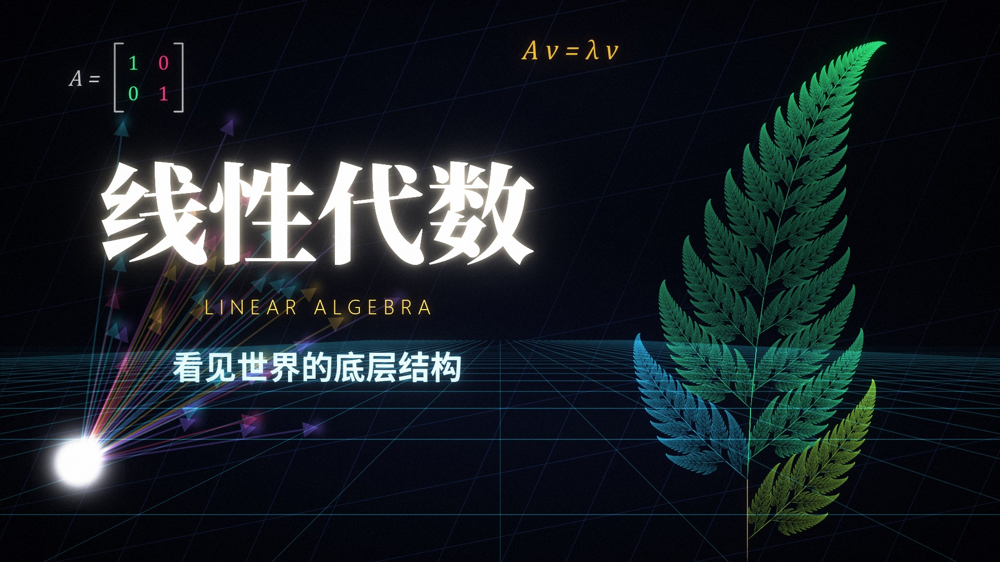

# 线性代数宣传片

一部 3 分 34 秒、1080p60 的线性代数宣传片：程序化渲染画面 + 程序合成配乐。



章节：向量 → 矩阵变换/行列式 → 特征向量流场 → 3D/4D → 分形 → SVD 图像压缩 → 傅里叶 → PageRank → AI/词向量 → 终章

## 运行
依赖：Python 3.12、numpy<2.5、numba、opencv-python、pillow、scipy、fonttools、ffmpeg（NVENC 可选，`LA_ENC=x264` 切换）。字体使用 Windows 自带/思源字体。

```bash
python render.py all -j 5      # 渲染各场景到 out/full/
python music.py                # 生成配乐 out/soundtrack.wav
python assemble.py             # 合成 线性代数宣传片.mp4
python cover.py                # 生成封面
```
预览：`python render.py s01 --preview --still 3,8`
